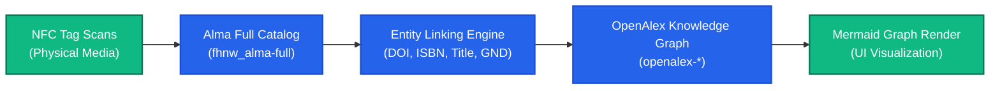

### Library RFID Dataspace Documentation

This documentation suite details the data architecture, entity relationships, and Mermaid graph visualization mechanisms connecting physical library RFID/NFC scans (`fhnw_alma-full`) with the OpenAlex scholarly knowledge graph (`openalex-*`).

---

### Documentation Modules

* [Elasticsearch Indices & Field Reference](./elasticsearch-indices.md)
  * Comprehensive schema definitions for `fhnw_alma-full` and all OpenAlex indices (`works`, `authors`, `sources`, `institutions`, `topics`, `subfields`, `fields`, `domains`, `publishers`, `funders`, `concepts`).
  * Identifier copy_to fields, barcodes, GND authorities, ROR, ORCID, and taxonomy mappings.

* [Entity Relationships & Linking Strategy](./entity-relationships-and-linking.md)
  * Detailed 4-tier pipeline connecting scanned physical barcodes to Alma records and OpenAlex scholarly nodes.
  * Internal physical catalog relations (co-authorship, GND subjects, physical shelf proximity).
  * Multi-item co-occurrence intelligence for detecting shared authors, common research topics, and citation connections across co-present items.

* [Mermaid Graph Visualization Specification](./mermaid-visualization.md)
  * Visual language, node shapes, semantic color schemes, and subgraph layouts.
  * Complete, valid Mermaid graph examples for single-item scans and multi-item co-presence scans.
  * Frontend integration guidelines with DaisyUI and `mermaid.js`.
