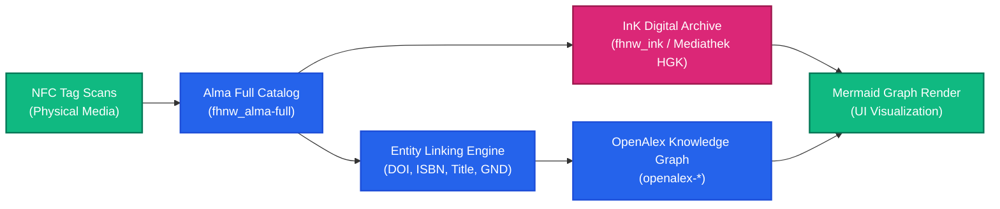

### Library RFID Dataspace Documentation

This documentation suite details the data architecture, entity relationships, and Mermaid graph visualization mechanisms connecting physical library RFID/NFC scans (`fhnw_alma-full`), the digital repository and archive Mediathek InK (`fhnw_ink` / `https://mediathek.hgk.fhnw.ch/ink/de`), and the OpenAlex scholarly knowledge graph (`openalex-*`).

---

### Documentation Modules

* [Elasticsearch Indices & Field Reference](./elasticsearch-indices.md)
  * Comprehensive schema definitions for `fhnw_alma-full`, `fhnw_ink`, and all OpenAlex indices (`works`, `authors`, `sources`, `institutions`, `topics`, `subfields`, `fields`, `domains`, `publishers`, `funders`, `concepts`).
  * Identifier copy_to fields, barcodes, GND authorities, ROR, ORCID, taxonomy mappings, and InK guest ACL filtering (`acl.meta = "global/guest"`).

* [Entity Relationships & Linking Strategy](./entity-relationships-and-linking.md)
  * Detailed multi-tier pipeline connecting scanned physical barcodes to Alma records, Mediathek InK digital repository items, and OpenAlex scholarly nodes.
  * Internal physical catalog relations (co-authorship, GND subjects, physical shelf proximity) and InK collection memberships.
  * Multi-item co-occurrence intelligence for detecting shared authors, common research topics, and citation connections across co-present items.

* [Mermaid Graph Visualization Specification](./mermaid-visualization.md)
  * Visual language, node shapes, semantic color schemes (`#db2777` for InK), and subgraph layouts.
  * Complete, valid Mermaid graph examples for single-item scans and multi-item co-presence scans across Alma, InK, and OpenAlex.
  * Frontend integration guidelines with DaisyUI and `mermaid.js`.
