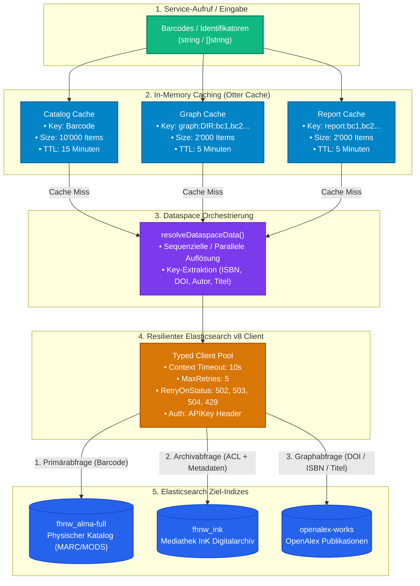
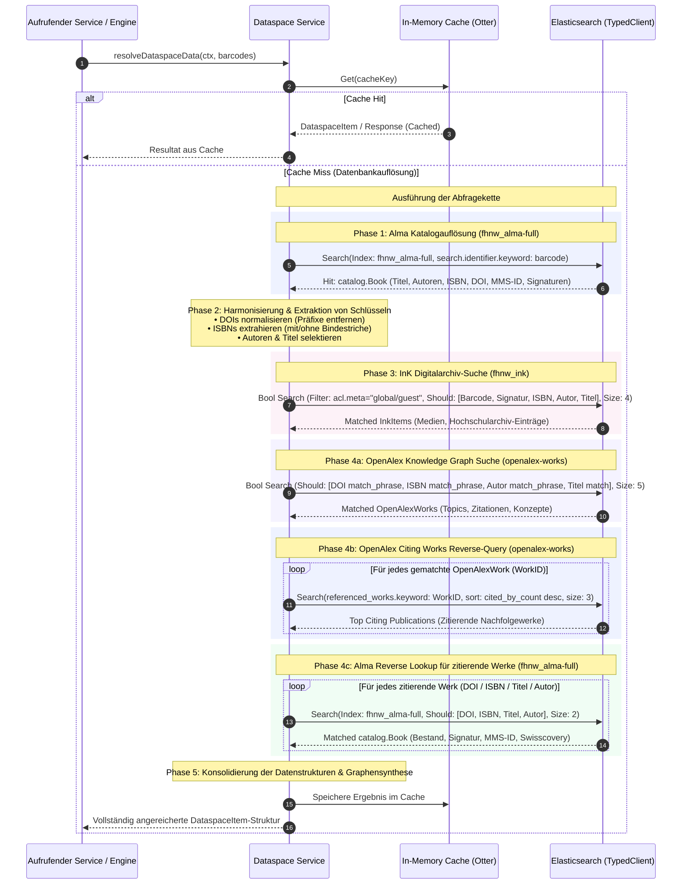
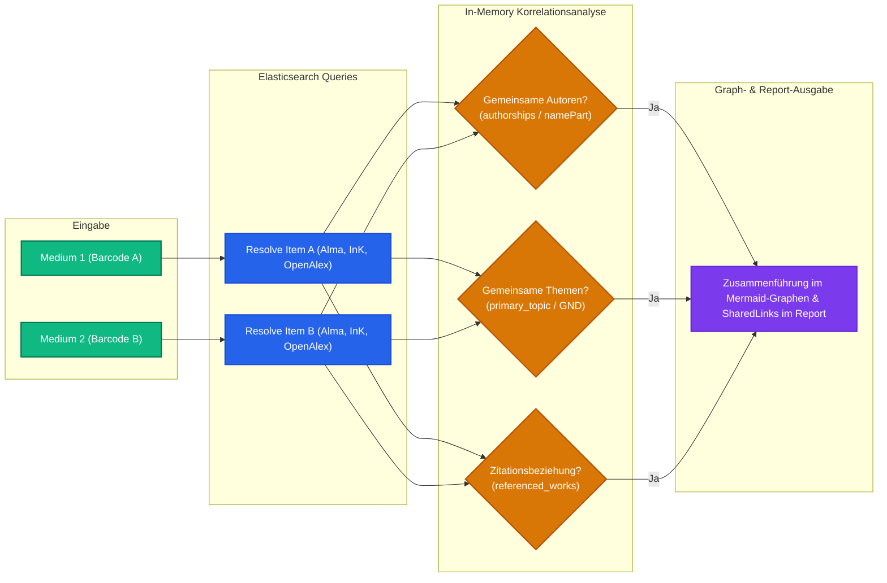

### Datenbankabfragen & Query-Ausführung im Library RFID Dataspace

Dieses Dokument beschreibt die Architektur, Ausführungsabläufe, Filtereigenschaften, Caching-Strategien und Resilienzmechanismen aller Datenbank- und Suchabfragen im Library RFID Dataspace Backend (ohne Web-Client- und HTTP-Controller-Ebene).

---

### 1. Architektur der Abfragelandschaft

Die Kernabfrage-Engine integriert physische Bibliotheksbestände mit digitalen Sammlungen und wissenschaftlichen Wissensgraphen über ein mehrstufiges Elasticsearch-Abfragemodell (Elasticsearch v8 Typed Client), gestützt durch In-Memory-Caching (`otter`).



---

### 2. Detaillierter Ablauf der Datenbankabfragen

Beim Aufruf der Abfragefunktionen (`resolveDataspaceData` / `ResolveDataspaceData` / `SearchByBarcode`) durchläuft die Abfrage-Pipeline einen deterministischen, mehrstufigen Prozess:



---

### 3. Spezifikation der einzelnen Datenbankabfragen & Eigenschaften

#### 3.1 Physischer Katalog (`fhnw_alma-full`)

Die Primärabfrage dient der Identifikation des physischen Buchs anhand des RFID-Barcodes.

* **Funktion**: `catalog.SearchByBarcode(ctx, client, index, barcode)`
* **Eigenschaften**:
  * **Ziel-Index**: Konfigurierbar über `elasticsearch.index` (Standard: `fhnw_alma-full`).
  * **Query-Typ**: Exakter Term-Match auf das Copy-To Keyword-Feld `search.identifier.keyword` bzw. `mapping.location.holding.items.barcode`.
  * **Filter**: Keine weiteren Filter (vollständiger Bestand des Bibliotheksnetzwerks SLSP/FHNW).
  * **Rückgabegröße**: Typischerweise 1 Treffer (eindeutiger Barcode).
  * **Erhaltene Entitäten**: MMS-ID, Haupt- und Untertitel, Autoren mit GND-IDs, Anreicherungs-ISBNs, DOIs, System-IDs, Signaturen und Standorte.

```json
{
  "query": {
    "term": {
      "search.identifier.keyword": "0001847294"
    }
  },
  "size": 1
}
```

---

#### 3.2 Digitalarchiv Mediathek InK (`fhnw_ink`)

Findet hochschulbezogene Mediendateien, Diplomarbeiten, Video-/Audioaufnahmen und Sonderbestände der Mediathek HGK.

* **Funktion**: `searchInkItems(ctx, client, index, barcode, authors, title, isbns)`
* **Eigenschaften**:
  * **Ziel-Index**: Konfigurierbar über `elasticsearch.ink_index` (Standard: `fhnw_ink`).
  * **Security / Access Control (ACL)**: Striktes `Filter`-Kriterium auf `acl.meta.keyword = "global/guest"`. Dokumente ohne Gastfreigabe werden bereits auf Datenbankebene ausgeschlossen.
  * **Disjunktive Suchkriterien (`should`)**:
    * Exakter Match auf Barcode: `meta.value`, `signature`, `signatureoriginal`.
    * Exakter Match auf alle extrahierten ISBNs: `meta.value`.
    * Phrasen-Match (`match_phrase`) auf Autoren: `persons.name`.
    * Text-Match (`match`) auf Titel: `title` (ignoriert Platzhalter wie `"Ohne Titel"`).
  * **Mindestübereinstimmung**: `minimum_should_match: "1"`.
  * **Ergebnislimit (`Size`)**: `4` Treffer (zur Begrenzung der Treffermenge und Optimierung der Datenverarbeitung).

```json
{
  "query": {
    "bool": {
      "filter": [
        {
          "term": {
            "acl.meta.keyword": "global/guest"
          }
        }
      ],
      "should": [
        { "match": { "meta.value": "0001847294" } },
        { "match": { "signature": "0001847294" } },
        { "match": { "signatureoriginal": "0001847294" } },
        { "match": { "meta.value": "978-3-8171-3420-1" } },
        { "match_phrase": { "persons.name": "Hertz, Heinrich" } },
        { "match": { "title": "Erinnerungen, Briefe, Tagebücher" } }
      ],
      "minimum_should_match": "1"
    }
  },
  "size": 4
}
```

---

#### 3.3 OpenAlex Scholarly Knowledge Graph (`openalex-works`)

Ermittelt Zitationsdaten, Forschungsthemen (Topics), akademische Disziplinen und Autorenprofile aus OpenAlex.

* **Funktion**: `searchOpenAlexWorks(ctx, client, index, isbns, title, authors, dois)`
* **Eigenschaften**:
  * **Ziel-Index**: Konfigurierbar über `elasticsearch.openalex_works_index` (Standard: `openalex-works`).
  * **Multi-Identifier Normalisierung**:
    * **DOI**: Bereinigt URL-Präfixe (`https://doi.org/`, `http://doi.org/`, `doi:`). Durchsucht `doi` und `ids.doi`.
    * **ISBN**: Sucht mit und ohne Bindestriche (`ids.isbn`) sowie als Fallback im `title`.
    * **Autor**: Exakter Phrasenabgleich auf `authorships.author.display_name`.
    * **Titel**: Match auf `title` und `display_name`.
  * **Mindestübereinstimmung**: `minimum_should_match: "1"`.
  * **Ergebnislimit (`Size`)**: `5` Treffer.
  * **Extrahierte Graphbeziehungen**: `primary_topic`, `topics` (mit `subfield`, `field`, `domain`), `authorships.author`, `authorships.institutions`, `locations.source`, `referenced_works`.

```json
{
  "query": {
    "bool": {
      "should": [
        { "match_phrase": { "doi": "10.1007/978-3-642-12345-6" } },
        { "match_phrase": { "ids.doi": "10.1007/978-3-642-12345-6" } },
        { "match_phrase": { "ids.isbn": "978-3-8171-3420-1" } },
        { "match_phrase": { "ids.isbn": "9783817134201" } },
        { "match": { "title": "978-3-8171-3420-1" } },
        { "match_phrase": { "authorships.author.display_name": "Heinrich Hertz" } },
        { "match": { "title": "Erinnerungen, Briefe, Tagebücher" } },
        { "match": { "display_name": "Erinnerungen, Briefe, Tagebücher" } }
      ],
      "minimum_should_match": "1"
    }
  },
  "size": 5
}
```

---

#### 3.4 OpenAlex Citing Works Reverse-Query (`openalex-works`)

Ermittelt top-zitierende wissenschaftliche Publikationen (Nachfolgearbeiten), die das gefundene Werk in ihrem Literaturverzeichnis (`referenced_works`) führen.

* **Funktion**: `searchOpenAlexCitingWorks(ctx, client, index, workID, limit)`
* **Eigenschaften**:
  * **Ziel-Index**: `openalex-works`.
  * **Matching**: Exakter Term- und Phrase-Match auf `referenced_works` / `referenced_works.keyword` mit der normalisierten OpenAlex Work-ID (sowohl als URI `https://openalex.org/W...` als auch als Kurzform `W...`).
  * **Sortierung**: Absteigend nach Zitationshäufigkeit (`cited_by_count: desc`), um die einflussreichsten Nachfolgearbeiten zuerst zu liefern.
  * **Ergebnislimit (`Size`)**: Standardmässig `3` Treffer.

```json
{
  "query": {
    "bool": {
      "should": [
        { "term": { "referenced_works.keyword": "https://openalex.org/W642892681" } },
        { "term": { "referenced_works.keyword": "W642892681" } },
        { "match_phrase": { "referenced_works": "https://openalex.org/W642892681" } },
        { "match_phrase": { "referenced_works": "W642892681" } }
      ],
      "minimum_should_match": "1"
    }
  },
  "sort": [
    {
      "cited_by_count": {
        "order": "desc"
      }
    }
  ],
  "size": 3
}
```

---

#### 3.5 Alma Reverse-Match für OpenAlex & Citing Works (`fhnw_alma-full`)

Prüft für in OpenAlex gefundene zitierende Folgearbeiten oder Publikationen, ob diese physisch oder lizenziert im Bibliotheksbestand (`fhnw_alma-full`) vorhanden sind.

* **Funktion**: `searchAlmaWorks(ctx, client, index, dois, isbns, title, authors)`
* **Eigenschaften**:
  * **Ziel-Index**: `fhnw_alma-full`.
  * **Disjunktive Suchkriterien (`should`)**:
    * **DOI**: Standardfeld `024.a`, `mapping.recordIdentifier` und `search.identifier.keyword`.
    * **ISBN**: MARC-Feld `020.a`, `mapping.identifier.isbn.id`, `mapping.identifier.isbn.enriched` sowie `search.identifier.keyword`.
    * **Autor**: MARC-Felder `100.a`, `700.a` sowie `mapping.name.personal.aut.namePart`.
    * **Titel**: `mapping.titleInfo.main.title` und MARC `245.a`.
  * **Mindestübereinstimmung**: `minimum_should_match: "1"`.
  * **Ergebnislimit (`Size`)**: `2` Treffer.
  * **Verknüpfte Entitäten**: MMS-ID, Signatur (`callNumber`), Zweigbibliothek/Holding-Standort und Swisscovery-Discovery-Link.

```json
{
  "query": {
    "bool": {
      "should": [
        { "match_phrase": { "024.a": "10.1000/182" } },
        { "match_phrase": { "search.identifier.keyword": "10.1000/182" } },
        { "match_phrase": { "mapping.titleInfo.main.title": "Quantum Theory of Optical Coherence" } },
        { "match_phrase": { "100.a": "Roy J. Glauber" } }
      ],
      "minimum_should_match": "1"
    }
  },
  "size": 2
}
```

---

### 4. Nicht-funktionale Eigenschaften & Abfrage-Matrix

Die folgende Tabelle fasst alle technischen Eigenschaften und Leistungsparameter der Abfragen zusammen:

| Eigenschaft / Parameter | Alma Katalog (`fhnw_alma-full`) | Mediathek InK (`fhnw_ink`) | OpenAlex Works (`openalex-works`) | OpenAlex Citing Reverse (`openalex-works`) | Alma Reverse Match (`fhnw_alma-full`) |
| :--- | :--- | :--- | :--- | :--- | :--- |
| **Abfragetyp** | Exact Match / Identifier Lookup | Filtered Multi-field Bool Query | Weighted Multi-identifier Bool Query | Reverse Reference Lookup + Sort | Multi-identifier Bool Query |
| **Primäre Matching-Keys** | Barcode / Identifier | Barcode, Signatur, ISBN, Autor, Titel | DOI, ISBN, Titel, Autor | Work ID in `referenced_works` | DOI, ISBN, Titel, Autor |
| **Sicherheitsfilter (ACL)** | Keine (Öffentlicher Katalog) | `acl.meta.keyword: "global/guest"` | Keine (Open Access Metadaten) | Keine (Open Access Metadaten) | Keine (Öffentlicher Katalog) |
| **Max. Trefferanzahl (`Size`)**| 1 | 4 | 5 | 3 | 2 |
| **In-Memory Caching** | 15 Minuten (`otter.Cache`) | 5 Minuten (als Teil des Graphen/Reports) | 5 Minuten (als Teil des Graphen/Reports) | 5 Minuten (als Teil des Graphen/Reports) | 5 Minuten (als Teil des Graphen/Reports) |
| **Cache Kapazität** | 10'000 Einträge | 2'000 Einträge | 2'000 Einträge | 2'000 Einträge | 2'000 Einträge |
| **Client Context Timeout** | 10 Sekunden | 10 Sekunden | 10 Sekunden | 10 Sekunden | 10 Sekunden |
| **Client Retry-Strategie** | 5 Retries bei `502, 503, 504, 429` | 5 Retries bei `502, 503, 504, 429` | 5 Retries bei `502, 503, 504, 429` | 5 Retries bei `502, 503, 504, 429` | 5 Retries bei `502, 503, 504, 429` |
| **Fehlerbehandlung** | Graceful Fallback (`hasCatalog = false`) | Graceful Fallback (Leere Trefferliste) | Graceful Fallback (Leere Trefferliste) | Graceful Fallback (Leere Trefferliste) | Graceful Fallback (Leere Trefferliste) |

---

### 5. Multi-Item Korrelation & Graphensynthese

Werden mehrere physische Medien gleichzeitig auf der Antenne platziert, führt das System nach Abschluss der Einzelabfragen eine vergleichende Analyse im Speicher durch:



1. **Gemeinsame Urheber**: Autoren, die an mehr als einem der gescannten Werke beteiligt sind, werden als einzelner Knoten im Mermaid-Graphen (`nodeAuthor`) konsolidiert.
2. **Thematische Cluster**: Werke mit identischen OpenAlex-Topics (`nodeTopic`) oder Alma-GND-Schlagwörtern verweisen auf dieselbe thematische Instanz.
3. **Zitationspfade**: Wenn `openalex-works.referenced_works` eines Mediums die Work-ID eines anderen aufliegenden Mediums enthält, wird eine hervorgehobene Kante (`==|CITES WORK|==>`) gerendert.
4. **Fehlertoleranz**: Schlägt eine der Datenbankabfragen fehl (z. B. Netzwerk-Timeout oder fehlender Treffer), wird das betroffene Medium als Basiselement (`Medium <Barcode> (Kein Katalogtreffer)`) dargestellt, ohne den Gesamtablauf für andere Medien zu blockieren.
