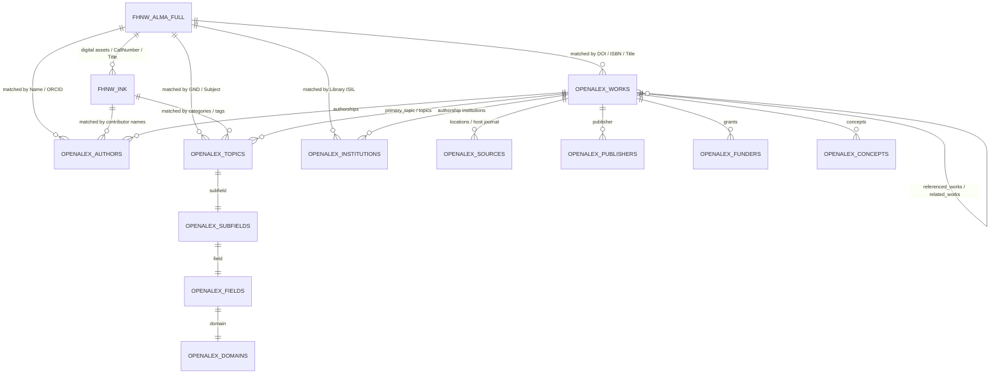

### Elasticsearch Indices & Schema Reference

This document provides a comprehensive specification of the relevant Elasticsearch indices and their data fields within the Library RFID Dataspace infrastructure. The environment combines physical library catalog metadata (`fhnw_alma-full`) with scholarly knowledge graph metadata from OpenAlex (`openalex-*`).

---

### 1. Overview of Available Indices



| Index Pattern | Entity Type | Primary Role in Dataspace | Approximate Doc Count |
| :--- | :--- | :--- | :--- |
| `fhnw_alma-full` | Library Catalog (Alma/MARC21) | Physical items, barcodes, holdings, signatures, MARC bibliographic records | > 10,000 |
| `fhnw_ink` | Digital Repository & Archive (Mediathek HGK) | Student theses, design archives, video recordings, audio, digital media assets (`https://mediathek.hgk.fhnw.ch/ink/de`) | > 10,000 |
| `openalex-works` | Scholarly Publications | Articles, books, preprints, DOI, citations, topics, referenced works | ~ 10,000 |
| `openalex-authors` | Researchers & Contributors | Author profiles, ORCID IDs, affiliations, historical topic areas | ~ 10,000 |
| `openalex-sources` | Journals, Repositories, Conferences | Publication venues, ISSN-L, publisher host organizations | ~ 10,000 |
| `openalex-institutions` | Academic & Research Organizations | Universities, ROR IDs, geographic coordinates, associated entities | ~ 10,000 |
| `openalex-topics` | Research Topics | Fine-grained subject clusters with domain/field taxonomies & keywords | 4,516 |
| `openalex-subfields` | Academic Subfields | 252 intermediate disciplines (e.g. *Energy Engineering and Power Technology*) | 252 |
| `openalex-fields` | Academic Fields | 26 overarching fields (e.g. *Energy*, *Computer Science*, *Medicine*) | 26 |
| `openalex-domains` | Broad Knowledge Domains | 4 high-level domains (*Physical Sciences*, *Life Sciences*, *Health Sciences*, *Social Sciences*) | 4 |
| `openalex-publishers` | Publishing Houses | Publisher hierarchies and corporate parent entities | ~ 10,000 |
| `openalex-funders` | Research Funding Agencies | Grant providers (e.g. SNSF, ERC, DFG, NIH) | ~ 10,000 |
| `openalex-concepts` | Conceptual Taxonomy | Wikidata-aligned subject terms and hierarchy levels | ~ 10,000 |

---

### 2. Physical Library Catalog Index (`fhnw_alma-full`)

The `fhnw_alma-full` index contains rich bibliographic records converted from Alma MARC21 and MODS schemas.

#### Key Fields for NFC Tag Matching and Entity Linking

* **Document Identifiers**:
  * `_id`: Elasticsearch document ID (e.g., `oai:alma.41SLSP_FNW:990049881560205518` or MMS ID).
  * `controlfield["001"]`: Alma MMS ID.
  * `mapping.recordIdentifier[]`: System IDs and repository identifiers.
  * `024.a` / `024.2`: Other standard identifiers (DOI, ISMN, URN).

* **Barcode and Item Tracking**:
  * `search.identifier.keyword`: Copy-to keyword field indexing item barcodes and identifiers for fast retrieval.
  * `mapping.location.holding[].items[].barcode`: Exact physical item barcode read from RFID tags via NFC WebSocket.
  * `mapping.location.holding[].items[].itemCallNumber`: Item-specific call number/shelf mark.
  * `mapping.location.holding[].library`: Library ISIL / code (e.g., `E44`, `E50`, `E60`, `A100`).
  * `mapping.location.holding[].location`: Physical branch location or shelf section.
  * `mapping.location.holding[].callNumber`: Holding call number.

* **Bibliographic Data (Titles & Descriptions)**:
  * `mapping.titleInfo.main[].title`: Primary title of the publication.
  * `mapping.titleInfo.main[].subTitle`: Subtitle or descriptive addendum.
  * `mapping.titleInfo.main[].sort`: Normalized sorting title.
  * `245.a`, `245.b`, `245.c`: Raw MARC title and statement of responsibility.

* **Authors and Contributors**:
  * `mapping.name.personal[].*.namePart`: Author personal name (e.g., `Hertz, Heinrich`, `Einstein, Albert`).
  * `mapping.name.personal[].*.identifier`: Authority ID (e.g., GND ID `(DE-588)11855008X`, ORCID, VIAF).
  * `mapping.name.personal[].*.role`: Contributor role (e.g., `aut`, `edt`, `ill`).
  * `mapping.name.corporate[].*.namePart`: Corporate author or institutional contributor.

* **Standard Identifiers (ISBN / ISSN / DOI)**:
  * `mapping.identifier.isbn[].id`: ISBN (ISBN-10 or ISBN-13).
  * `mapping.identifier.isbn[].enriched`: Sanitized/normalized 13-digit ISBN.
  * `020.a`: MARC ISBN field.

* **Subject Classifications & Keywords**:
  * `mapping.subject.topic[].*.label`: Subject heading (e.g., *Electromagnetism*, *Architecture*, *Design*).
  * `mapping.subject.topic[].*.identifier`: GND authority identifier.
  * `mapping.subject.genre.*`: Genre/form designations.
  * `mapping.subject.local.all[]`: Local classification terms and keywords.
  * `082.a` / `084.a`: DDC (Dewey Decimal) or local classification numbers.

* **Publication & Origin**:
  * `mapping.originInfo.event.publication[].publisher[]`: Publisher name.
  * `mapping.originInfo.event.publication[].place[]`: Publication location.
  * `mapping.originInfo.event.publication[].dateString`: Publication year/date string.
  * `mapping.originInfo.copyrightDate[]`: Copyright year.

---

### 3. Digital Archive & Repository Index (`fhnw_ink`)

The `fhnw_ink` index contains digital media assets, student theses, video lectures, audio files, and special collection items from the **Mediathek HGK FHNW InK platform** ([https://mediathek.hgk.fhnw.ch/ink/de](https://mediathek.hgk.fhnw.ch/ink/de)).

#### Access Control List (ACL) & Guest Permissions
* **Important**: InK uses granular Access Control Lists (`acl`). Queries for public/guest frontend representation must strictly filter by:
  ```json
  {"term": {"acl.meta.keyword": "global/guest"}}
  ```
  or `{"match": {"acl.meta": "global/guest"}}`.

#### Key Fields for Media Retrieval & Dataspace Graph Linking

* **Identifiers & Routing**:
  * `signature`: Unique InK record identifier (e.g. `forms2-2018.971913`, `zotero2-2612786.GTX524X5`, `iid-Arbeit-2428`).
  * `signatureoriginal`: Original signature or item identifier.
  * **Detail URL pattern**: `https://mediathek.hgk.fhnw.ch/ink/detail/<signature>/de`
  * **Search URL pattern**: `https://mediathek.hgk.fhnw.ch/ink/grid/de?search=<query>`
  * `source`: Source system or catalog namespace (e.g. `forms2-2018`, `zotero2`, `iid-Arbeit`, `kasko`).

* **Bibliographic Data**:
  * `title`: Title of the work, thesis, artwork, video recording, or project.
  * `collectiontitle`: Archive collection name (e.g., *Diplom HGK*, *Archiv Institut Industrial Design*, *Kasko_Digital*, *Beispiel_Enge-Gusewski*).
  * `series`: Series title or semester workshop designation.
  * `place`: Place of origin (e.g. *Basel*, *Aarau*).
  * `date`: Year or date string (e.g. `2018`, `2016-05-25`).
  * `publisher`: Publishing or producing entity.
  * `abstract`: Descriptive text or project summary.

* **Creators & Contributors**:
  * `persons[]`: Array of contributor objects with `persons[].name` and `persons[].role` (e.g. `creator`, `director`, `author`, `student`).
  * `statistics.person[]`: Aggregated list of person entities.

* **Classification & Categorization**:
  * `catalog[]`: InK catalog buckets (e.g. `lehrenlernen`, `diplom`, `archiv`).
  * `category[]`: Hierarchical category tags (e.g. `zotero2!!Beispiel_Enge-Gusewski`).
  * `tags[]`: Subject and thematic tags.
  * `type` / `mediatype[]`: Media type descriptor (e.g. `videoRecording`, `thesis`, `audio`, `image`, `document`).

* **Meta & External References**:
  * `meta[]`: Key-value properties including `CallNumber`, `ISBN`, `Creators`, `ItemType`, `Url`, `DateAdded`.
  * `url`: Direct link to external media resources (e.g. YouTube, project website, repository).
  * `media`: Embedded media assets with MIME types, image dimensions, URIs, and durations.

---

### 4. OpenAlex Scholarly Indices (`openalex-*`)

#### 4.1 `openalex-works` (Scholarly Works)
Represents journal articles, monographs, conference papers, preprints, and datasets.

* `id`: Canonical OpenAlex work ID (URI format: `https://openalex.org/W...`).
* `doi`: Canonical DOI URL (e.g., `https://doi.org/10.1007/...`).
* `title` / `display_name`: Normalized title of the publication.
* `publication_year`: Integer year of publication.
* `publication_date`: ISO date string (`YYYY-MM-DD`).
* `ids`: Object mapping identifier types:
  * `ids.openalex`: Work URI.
  * `ids.doi`: Normalized DOI string.
  * `ids.mag`: Microsoft Academic Graph ID.
  * `ids.pmid`: PubMed ID.
* `authorships[]`: Array of author contributions:
  * `authorships[].author.id`: Author URI (`https://openalex.org/A...`).
  * `authorships[].author.display_name`: Author name.
  * `authorships[].author.orcid`: Author ORCID URI (`https://orcid.org/...`).
  * `authorships[].author_position`: Position (`first`, `middle`, `last`).
  * `authorships[].institutions[]`: Array of affiliated institutions (`id`, `display_name`, `ror`, `country_code`).
* `primary_topic`: Primary research topic:
  * `primary_topic.id`: Topic URI (`https://openalex.org/T...`).
  * `primary_topic.display_name`: Topic name (e.g., *Electromagnetic Waves and Antenna Design*).
  * `primary_topic.score`: Confidence score.
  * `primary_topic.subfield`: Subfield object (`id`, `display_name`).
  * `primary_topic.field`: Field object (`id`, `display_name`).
  * `primary_topic.domain`: Domain object (`id`, `display_name`).
* `topics[]`: Array of assigned research topics with hierarchical metadata and scores.
* `concepts[]`: Array of concepts (`id`, `display_name`, `wikidata`, `level`, `score`).
* `primary_location` / `locations[]`:
  * `source.id`: Publication source URI (`https://openalex.org/S...`).
  * `source.display_name`: Journal or repository title.
  * `source.issn_l`: Linking ISSN.
  * `source.host_organization`: Publisher / host institution URI (`https://openalex.org/P...`).
  * `is_oa`: Boolean flag indicating Open Access.
  * `pdf_url` / `landing_page_url`: Direct links to the full text.
* `referenced_works[]`: Array of work URIs cited by this work.
* `related_works[]`: Array of algorithmically related OpenAlex work URIs.
* `cited_by_count`: Total citation count.
* `grants[]`: Funding information (`funder`, `funder_display_name`, `award_id`).

#### 4.2 `openalex-authors` (Authors & Researchers)
Represents scholars and contributing creators.

* `id`: Author URI (`https://openalex.org/A...`).
* `display_name`: Full author name.
* `display_name_alternatives[]`: Transliterated or alternative name spellings.
* `orcid`: Canonical ORCID URL (`https://orcid.org/0000-...`).
* `last_known_institutions[]`: Recent institutional affiliations (`id`, `display_name`, `ror`, `country_code`).
* `affiliations[]`: History of affiliations with year ranges and institutions.
* `topics[]`: Key topic areas associated with the author's research output.
* `x_concepts[]`: High-level concepts associated with the author.
* `works_count`: Total authored works count.
* `cited_by_count`: Total received citations.
* `summary_stats`: Statistical indicators (`h_index`, `i10_index`, `2yr_mean_citedness`).

#### 4.3 `openalex-topics`, `subfields`, `fields`, and `domains` (Knowledge Taxonomy)
Represents OpenAlex's 4-tier hierarchical topic classification system.

* **`openalex-topics`**:
  * `id`: Topic URI (`https://openalex.org/T...`).
  * `display_name`: Human-readable topic label.
  * `description`: Summary of the topic scope.
  * `keywords[]`: List of characteristic keywords.
  * `subfield`: Associated subfield (`id`, `display_name`).
  * `field`: Associated field (`id`, `display_name`).
  * `domain`: Associated domain (`id`, `display_name`).
  * `siblings[]`: Closely related peer topics (`id`, `display_name`).
* **`openalex-subfields`** (252 entities):
  * `id`: Subfield URI (`https://openalex.org/subfields/...`).
  * `display_name`: Subfield name.
  * `field`: Parent field (`id`, `display_name`).
  * `domain`: Top-level domain (`id`, `display_name`).
  * `description`: Disciplinary definition.
* **`openalex-fields`** (26 entities):
  * `id`: Field URI (`https://openalex.org/fields/...`).
  * `display_name`: Field name (e.g., *Computer Science*, *Physics and Astronomy*, *Engineering*).
  * `domain`: Parent domain (`id`, `display_name`).
* **`openalex-domains`** (4 entities):
  * `id`: Domain URI (`https://openalex.org/domains/...`).
  * `display_name`: Domain name (*Physical Sciences*, *Life Sciences*, *Health Sciences*, *Social Sciences*).

#### 4.4 `openalex-institutions` (Institutions & Universities)
Represents research institutions, libraries, and universities.

* `id`: Institution URI (`https://openalex.org/I...`).
* `display_name`: Institutional name (e.g., *University of Applied Sciences and Arts Northwestern Switzerland*).
* `ror`: ROR identifier URL (`https://ror.org/...`).
* `country_code`: Two-letter ISO country code.
* `type`: Organization classification (`education`, `facility`, `company`, `nonprofit`, `government`).
* `associated_institutions[]`: Sub-colleges, partner facilities, or parent universities.
* `geo`: Geographic coordinates (`city`, `region`, `country`, `latitude`, `longitude`).

#### 4.5 `openalex-sources` & `openalex-publishers`
* **`openalex-sources`**: Journal and conference venue profiles (`id`, `display_name`, `issn_l`, `host_organization`, `type`).
* **`openalex-publishers`**: Publishing entities and parent conglomerates (`id`, `display_name`, `country_codes`, `hierarchy_level`, `parent_publisher`).
