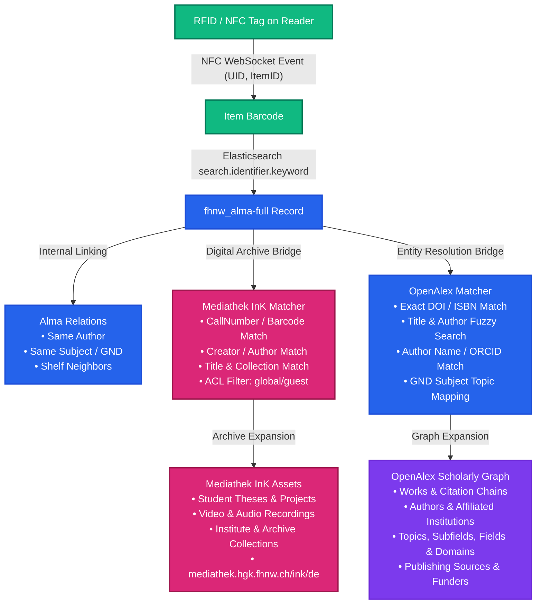
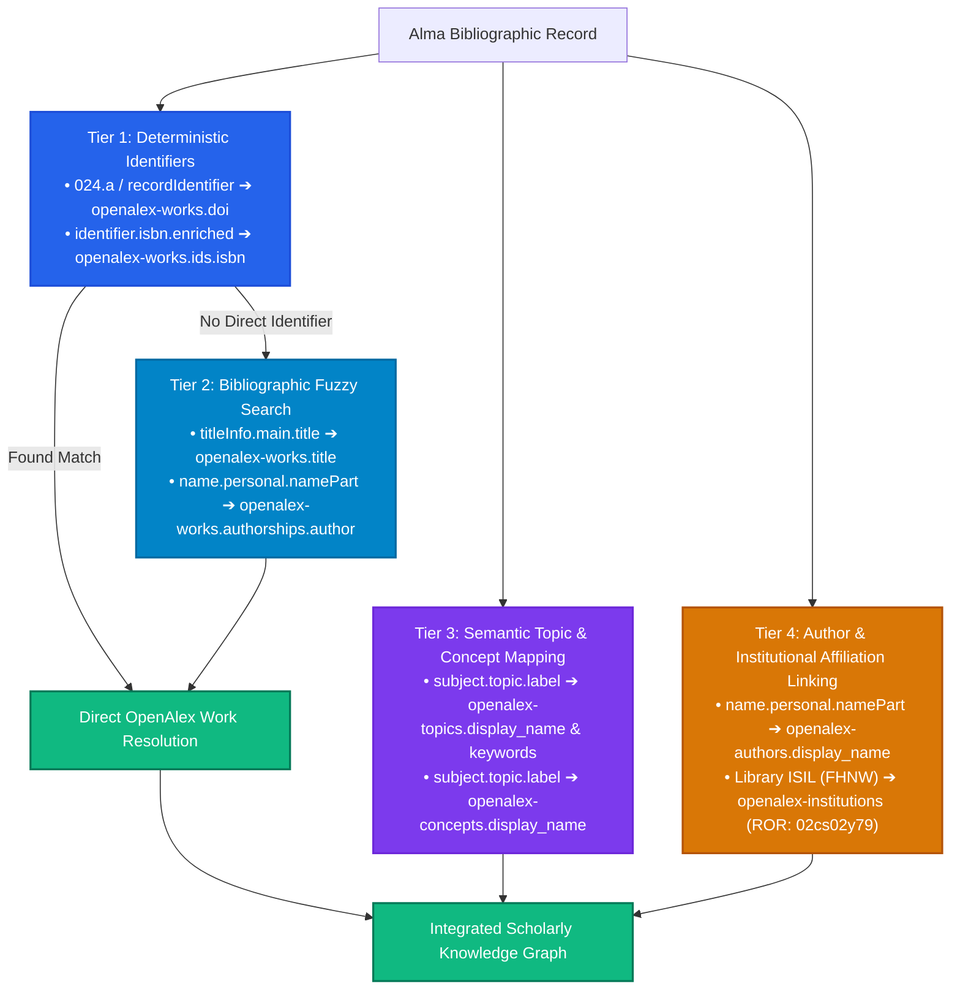
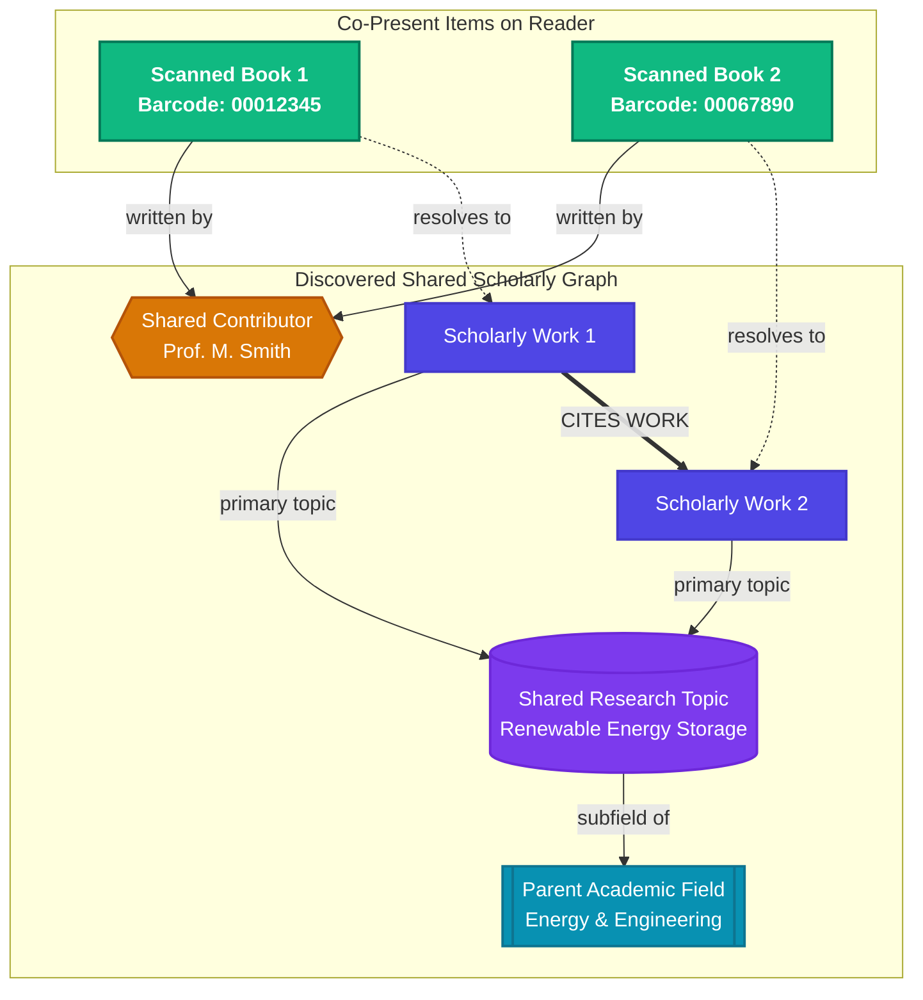

### Entity Relationships and Linking Strategy

This document specifies how bibliographic records retrieved from physical RFID/NFC tag scans via `fhnw_alma-full` are matched, interconnected, and bridged into the OpenAlex scholarly knowledge graph (`openalex-*`).

---

### 1. Ingestion Flow: Physical RFID Tag to Knowledge Graph



1. **Tag Discovery**: When an RFID tag is placed on the reader, the desk service emits a WebSocket event containing the Item ID (barcode) and UID.
2. **Catalog Resolution**: The backend queries `fhnw_alma-full` using `search.identifier.keyword` to fetch the primary MARC/MODS bibliographic record.
3. **Graph Expansion**: The system executes targeted Elasticsearch queries to discover both internal Alma relations and corresponding OpenAlex entities.

---

### 2. Physical Catalog Linking (Alma to Alma)

When one or more books are scanned, the physical catalog offers multiple dimensions of relation:

#### 2.1 Co-Authorship & Author Collections
* **Query Match**: `mapping.name.personal.*.namePart` or authority ID (`mapping.name.personal.*.identifier`).
* **Semantic Relation**: `(Book A) -- [written by] --> (Author) <-- [written by] -- (Book B)`
* **Utility**: Reveals other physical holdings by the same creator in the library network.

#### 2.2 Thematic / Subject Similarity
* **Query Match**: Exact match on GND subject identifiers (`mapping.subject.topic.*.identifier`) or fuzzy text match on subject labels (`mapping.subject.topic.*.label`, `mapping.subject.local.all`).
* **Semantic Relation**: `(Book A) -- [shares topic] --> (GND Subject) <-- [shares topic] -- (Book B)`
* **Utility**: Groups physical books that address the same disciplinary topic or artistic concept.

#### 2.3 Shelf & Location Proximity (Physical Browsing)
* **Query Match**: Common prefix on `mapping.location.holding.callNumber` and identical `mapping.location.holding.library`.
* **Semantic Relation**: `(Book A) -- [shelf neighbor at] --> (Holding Location) <-- [shelf neighbor at] -- (Book B)`
* **Utility**: Enables virtual shelf browsing of physically adjacent items.

---

### 3. Bridging Alma Records to OpenAlex Entities

Connecting physical library catalog items to OpenAlex creates an enriched scholarly graph. The bridge employs a tiered matching pipeline:



#### 3.1 Work Matching (Tier 1 & 2)
* **Target Index**: `openalex-works`
* **Query Structure**:
  * *Step A (Exact DOI)*: `{"term": {"doi.keyword": "<normalized_doi>"}}`
  * *Step B (ISBN)*: `{"term": {"ids.isbn.keyword": "<sanitized_isbn13>"}}`
  * *Step C (Title + Author)*:
    ```json
    {
      "query": {
        "bool": {
          "must": [
            { "match_phrase": { "title": "<alma_title>" } }
          ],
          "should": [
            { "match": { "authorships.author.display_name": "<author_name>" } }
          ]
        }
      }
    }
    ```

#### 3.2 Author Profile Resolution
* **Target Index**: `openalex-authors`
* **Query Structure**: Match author surname and given name against `display_name` and `display_name_alternatives`. If an ORCID is present in the MARC authority field, match on `orcid.keyword`.
* **Discovered Attributes**: Author h-index, total citations, historical research institutions, top publication topics.

#### 3.3 Topical and Conceptual Resolution
* **Target Indices**: `openalex-topics` and `openalex-concepts`
* **Query Structure**: Match subject strings (`mapping.subject.topic.*.label`, `mapping.subject.local.all`) against `openalex-topics.display_name` and `keywords`, or `openalex-concepts.display_name`.
* **Discovered Attributes**: Broad academic field, subfield, high-level domain, and sibling research topics.

#### 3.4 Institutional and Source Resolution
* **Target Indices**: `openalex-institutions`, `openalex-sources`, `openalex-publishers`
* **Links**:
  * Connecting Alma holding institutions (e.g., FHNW libraries) with OpenAlex Institution profiles (`https://openalex.org/I11756543`).
  * Connecting publishers (`mapping.originInfo.event.publication.publisher`) with `openalex-publishers` or `openalex-sources`.

---

### 4. OpenAlex Internal Graph Traversal

Once an OpenAlex work, author, or topic is anchored, the following second-degree relations are traversed:

| Source Entity | Relationship Edge | Target Entity | Edge Meaning |
| :--- | :--- | :--- | :--- |
| `openalex-works` | `authorships.author.id` | `openalex-authors` | "authored by" |
| `openalex-works` | `authorships.institutions.id` | `openalex-institutions` | "affiliated institution" |
| `openalex-works` | `primary_topic.id` | `openalex-topics` | "primary research topic" |
| `openalex-works` | `concepts.id` | `openalex-concepts` | "treats concept" |
| `openalex-works` | `locations.source.id` | `openalex-sources` | "published in journal/source" |
| `openalex-works` | `referenced_works[]` | `openalex-works` | "cites work" |
| `openalex-works` | `grants.funder` | `openalex-funders` | "funded by" |
| `openalex-topics` | `subfield.id` | `openalex-subfields` | "belongs to subfield" |
| `openalex-subfields` | `field.id` | `openalex-fields` | "belongs to field" |
| `openalex-fields` | `domain.id` | `openalex-domains` | "belongs to domain" |
| `openalex-topics` | `siblings.id` | `openalex-topics` | "related sibling topic" |
| `openalex-authors` | `last_known_institutions.id`| `openalex-institutions` | "current affiliation" |

---

### 5. Multi-Item Co-Occurrence Intelligence

When multiple physical books are detected simultaneously on the RFID reader (e.g., during checkout or desk interaction), the dataspace analyzes shared graph nodes to surface hidden connections:



1. **Shared Authors**: Detects if books were authored, edited, or illustrated by the same person.
2. **Shared Classification & Topics**: Identifies common OpenAlex topics, subfields, or GND subject terms.
3. **Citation & Influence Paths**: Finds citation links between the works or their immediate references in OpenAlex.
4. **Institutional Overlap**: Highlights common research centers or universities associated with the authors.
