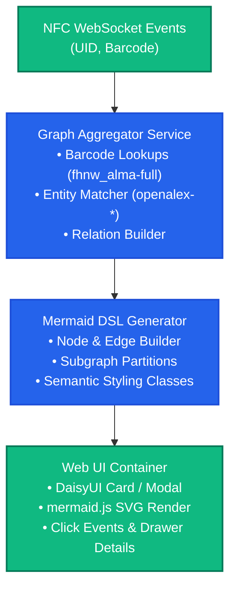
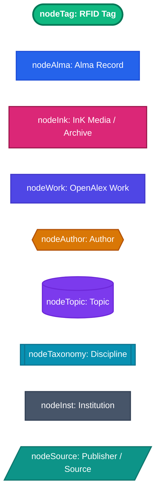
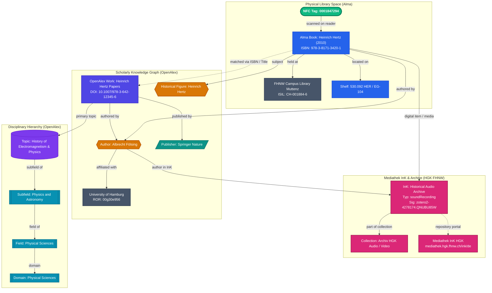
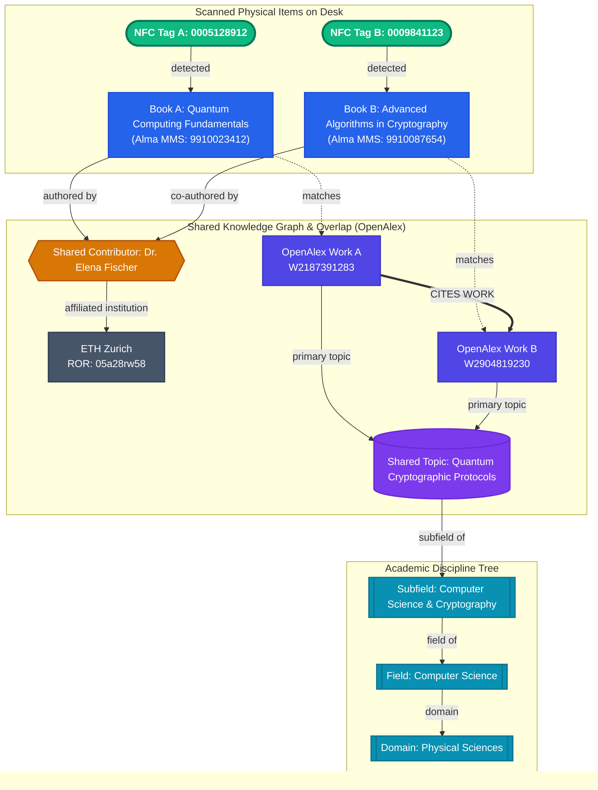

### Mermaid Graph Visualization Specification

This document defines the schema, styling conventions, and concrete examples for rendering interactive Mermaid graph visualizations of physical RFID/NFC library items and their corresponding OpenAlex scholarly knowledge graph relations.

---

### 1. Visualization Architecture & UI Integration

When physical RFID tags are read via WebSocket, the dataspace constructs a graph model representing the physical Alma holdings and their enriched OpenAlex metadata. The backend/frontend translates this graph into a standard Mermaid `flowchart TD` definition.



---

### 2. Node Schema & Visual Styling

To ensure clarity and accessibility, nodes are visually categorized using semantic classes and shapes:

| Entity Type | Shape | CSS Class | Color Scheme / Meaning |
| :--- | :--- | :--- | :--- |
| **Scanned RFID Tag** | Stadium `([Label])` | `nodeTag` | Bright Emerald / Active physical scan |
| **Alma Catalog Record** | Rounded Rectangle `[Label]` | `nodeAlma` | Royal Blue / Physical library holding |
| **InK Digital Archive / Asset** | Rectangle `[Label]` | `nodeInk` | Rose / Mediathek InK digital asset / collection |
| **OpenAlex Work** | Rounded Rectangle `[Label]` | `nodeWork` | Deep Indigo / Scholarly publication |
| **Author / Scholar** | Hexagon `{{Label}}` | `nodeAuthor` | Amber / Researcher & creator |
| **Research Topic** | Cylinder `[(Label)]` | `nodeTopic` | Purple / Specific research topic |
| **Academic Discipline** | Subroutine `[[Label]]` | `nodeTaxonomy`| Cyan / Subfield, Field, Domain |
| **Institution / Library** | Rectangle `[Label]` | `nodeInst` | Slate / University or library branch |
| **Publisher / Source** | Parallelogram `[/Label/]` | `nodeSource` | Teal / Journal or publishing house |

#### Visual Node Legend & Style Definitions



```text
%% Reusable Mermaid classDef snippet for Dataspace Graphs
classDef nodeTag fill:#10b981,stroke:#047857,stroke-width:3px,color:#ffffff,font-weight:bold;
classDef nodeAlma fill:#2563eb,stroke:#1d4ed8,stroke-width:2px,color:#ffffff;
classDef nodeInk fill:#db2777,stroke:#9d174d,stroke-width:2px,color:#ffffff;
classDef nodeWork fill:#4f46e5,stroke:#4338ca,stroke-width:2px,color:#ffffff;
classDef nodeAuthor fill:#d97706,stroke:#b45309,stroke-width:2px,color:#ffffff;
classDef nodeTopic fill:#7c3aed,stroke:#6d28d9,stroke-width:2px,color:#ffffff;
classDef nodeTaxonomy fill:#0891b2,stroke:#0e7490,stroke-width:2px,color:#ffffff;
classDef nodeInst fill:#475569,stroke:#334155,stroke-width:2px,color:#ffffff;
classDef nodeSource fill:#0d9488,stroke:#0f766e,stroke-width:2px,color:#ffffff;
```

---

### 3. Concrete Example 1: Single Scanned Physical Book

The following example visualizes a single scanned physical book (*Heinrich Hertz: Erinnerungen, Briefe, Tagebücher*), linking the physical item to its Alma bibliographic record, author, holding library, related Mediathek InK digital repository assets, and the corresponding OpenAlex work, topic hierarchy, and academic institution.



---

### 4. Concrete Example 2: Multi-Item Co-Occurrence Intelligence

When two or more physical books are scanned simultaneously on the RFID reader desk, the graph highlights shared intersections (e.g., shared authors, cross-citations, common research topics, and joint institutional affiliations).



---

### 5. Frontend Rendering Guidelines

1. **Client-Side Mermaid Initialization**:
   * Include Mermaid library in the web bundle (`mermaid.min.js`).
   * Initialize with dark/light theme awareness matching DaisyUI themes.
2. **Dynamic Generation**:
   * When WebSocket tag updates are processed, serialize the entity graph into the Mermaid DSL string.
   * Target container element: `<div class="mermaid" id="dataspace-graph">...</div>`.
   * Call `mermaid.run()` or `mermaid.render('graph-svg', dslString)` to update the DOM reactively.
3. **Interactivity**:
   * Attach click handlers to node IDs to open drawer/modal metadata views (e.g. Alma copy catalog flyout, OpenAlex source URL, ORCID profile, or Google Scholar search).
